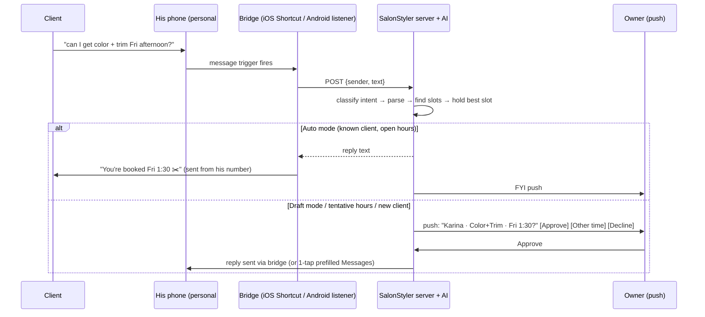

# Chairside — Product & Technical Plan (v3)

A Vagaro replacement for independent stylists and small salons. The selling point is an **AI "text-to-booking" assistant** that turns messy client texts into fitting time slots. It starts with one stylist and is built to sell to other salons.

---

## 1. Decisions locked in
| Area | Decision |
|---|---|
| Positioning | **Replace Vagaro** (~$30/mo). Cheaper, AI-first, built to resell. |
| Tenancy | **Multi-tenant from day one** (`salon_id` on everything). v1 UI = one stylist per salon. |
| Platforms | **iPhone first for v1** (owner app). Web for local testing + the public booking page. Android follows (same Expo codebase). |
| Client channel | **Texts (iMessage/SMS) to his personal number** containing the keyword **"Chairside"** (e.g., "Chairside schedule me Fri for color"), forwarded by the iOS Shortcut bridge (§4) |
| Autonomy | **Default = Draft.** Every reply needs his approval, and he can edit the message. Per-salon toggle to enable auto-replies later. |
| Unanswered requests | Push → no response after **1 day (adjustable)** → **follow-up push**: "You haven't responded to Karina's request" [Respond] [Ignore]. Hold expiry is also adjustable (default 1 day). |
| Booking window | Configurable, from weeks to months out. **Clients can cancel** (link in confirmation or by replying "cancel"). |
| New clients | Auto-create a client profile on first contact, then they can self-book |
| Vagaro must-haves for v1 | **Scheduling, services, deposits, card-tap checkout** |
| AI | Bring-your-own key (OpenAI / Anthropic / Gemini) **and** a paid tier with AI included (platform key + usage metering) |
| Backend | Supabase (Postgres + RLS, Auth, Realtime, Edge Functions, Storage, pg_cron, Vault) |
| Hours | Open / **Tentative** (bookable, but he approves) / Closed |
| UI style | **Minimal, ultra-modern, native iOS feel** (see §5b). Theming/branding (logo, accent color) comes later via design tokens. |
| His business | **Booth renter.** Track booth rent, expenses, and tips for taxes. Sells **retail products**. Books others during color processing. |
| Payments | **Pay after service** is the norm: Stripe Terminal **Tap to Pay on iPhone** is the core. Deposits are **optional, off by default**, and can be enabled per service. |
## 2. The core problem & how we automate it
> Clients text "can I get a balayage + trim next Friday afternoon?" and he has to work out how long that takes and where it fits.

**Solution = 3 pieces:**
1. **Service builder** that knows real timing, including processing gaps (§3).
2. **Deterministic availability engine** that packs services into open time (§5).
3. **AI parser** that turns free text into `{client, services[], date window, time preference}`, calls the engine, and drafts a reply (§4).

The AI only *interprets*. All time math comes from code, so it can't invent an available slot.

## 3. Service builder (create services in-app)
Each service is a sequence of **segments**:

| Field | Example (Full Color) |
|---|---|
| Name, category, price, color tag | Full Color · Color · $120 · 🟣 |
| Segments | **Apply 30m (busy)** → **Process 35m (free\*)** → **Rinse/Style 30m (busy)** |
| Buffer before/after | 0 / 10m cleanup |
| Variants | Short / Medium / Long hair adjust durations (+0 / +15 / +30m) |
| Flags | Requires consultation · New clients only · Bookable online · Deposit |

\***Processing time is the key feature.** During a "free" segment he can fit a short service (e.g., a men's cut) for someone else. Vagaro has this ("gap time"), and it's how stylists make money.

- **Add-ons:** e.g., Toner +15m, Deep Conditioning +10m.
- **Combos:** "Balayage + Trim" builds the segments in order and sums durations automatically.
- **Per-client overrides:** "Karina's color always takes +20m". Learned from history and suggested to him.
- **Booking result:** an appointment stores its **resolved segments**. The calendar blocks the busy segments and shows free segments as hatched but bookable.

## 4. Agentic Inbox: client texts flow in automatically
Goal: a client texts his **normal phone number** and the app proposes a booking within seconds, without screenshots or pasting. He just taps **Approve** on a notification.



### Bridges, in order of smoothness
| # | Bridge | Platform | Smoothness | Notes |
|---|---|---|---|---|
| A | **Android notification listener** | Android | ⭐⭐⭐ fully hands-free | The app reads incoming message notifications (SMS, WhatsApp, IG, FB) with user-granted Notification Access. It replies with the notification's built-in **direct-reply** action, the same way Play Store auto-responder apps work. Needs a custom Expo native module. |
| B | **iOS Shortcuts automation** (we ship a one-tap-install Shortcut) | iPhone | ⭐⭐ near hands-free | Message trigger → "Get contents of URL" posts sender + text to our API → can **Send Message** with the reply automatically ("Run Immediately"; iOS 17+). Uses the native **"Message Contains: Chairside"** filter (§4 keyword trigger). iMessage/SMS only. **Needs a prototype spike first.** |
| C | **Instagram DMs** (Meta Messaging API, business account) | Server-side | ⭐⭐⭐ | Webhook → AI → reply within Meta's 24h window. Many salon clients book via IG. Requires Meta app review. |
| D | **AI booking line** (toll-free number, Twilio) | Server-side | ⭐⭐⭐ fully autonomous | Cleanest and most scalable for the SaaS. Toll-free verification takes days and costs ~$2/mo + ~1¢/msg. Clients text a different number, so this is offered as an upgrade. |
| E | Share sheet / paste / screenshot | All | ⭐ manual fallback | Always available. Works with any app. |

**v1 = B (iOS Shortcut) + E (manual fallback).** A (Android) comes with the Android release, and C/D in v2. All bridges feed the same `/inbox` endpoint and agent.

**iOS Shortcut bridge details (v1):**
- We ship an **"Add to Shortcuts" install link** from onboarding with his API token pre-filled. He creates the Message automation once (guided, about 60 sec). Set it to "Run Immediately".
- **Keyword trigger (primary):** clients start their text with **"Chairside"**, e.g. *"Chairside schedule me Dec 18 for a cut"*. The automation uses iOS's native **Message Contains = "Chairside"** filter, so it runs only for intentional booking requests.
  - Why: reliable native filter (no hacks), **private** (no other texts leave his phone), clear client intent, and every client learns the brand.
  - Keyword is a per-salon setting (default "Chairside"). Onboarding sets up a second automation for the autocorrect variant **"Chair side"**.
  - The server strips the keyword and parses the rest. Messages with only the keyword ("Chairside") get a help reply: *"Tell me the service + day, e.g. 'Chairside cut next Fri afternoon'"*.
  - **Teaching the keyword:** every confirmation includes *"Next time just text 'Chairside' + what you need ✂️"*. Also add a station card / QR code and an Instagram bio line. Optionally, the reminder queue adds a one-time "new way to book" intro text to existing clients.
  - **Texts without the keyword** are untouched. He can use the share-sheet fallback (Bridge E) or reply with the keyword tip.
  - The **day-1 spike** confirms: whether matching ignores capitals, behavior with autocorrect, Run Immediately on a locked phone, iMessage and green-bubble SMS, and group threads (ignored).
- Inbound: the Shortcut posts `{sender, text}` → the server returns `{action: none | notify}`. In v1 Draft mode the Shortcut just forwards. It never replies on its own.
- Outbound on Approve: the push opens the app → the reply editor (prefilled, editable) → **Send** opens Messages prefilled to the client (one tap). When he enables auto-replies, the Shortcut sends the server's reply directly.
- Lifecycle: request → push → (no response in **1 day**, adjustable) **follow-up push** "Still waiting: Karina's request" [Respond] [Ignore] → ignored requests release the hold.

### Privacy guardrails (these read his personal messages)
- On iPhone, only messages containing the salon keyword ("Chairside") are forwarded. Everything else stays on the phone. (Android bridge: an on-device prefilter does the same.)
- The server stores parsed requests, not full message history. Clear disclosure + an on/off toggle per bridge.
- The AI never replies to unknown or non-booking messages. Those are ignored or flagged.

### Manual flow (fallback, and the UI for Draft mode)
1. The app shows parsed details: *Karina M. · Full Color (long) + Trim · 3h05 · Fri Dec 18 PM*. Each field can be edited.
2. Shows ranked slots: requested day first, then ±3 days, with best fits on top (fewest dead gaps).
3. He taps a slot → a **hold** is created → AI drafts a reply in his voice: *"Hey Karina! I've got Fri 12/18 at 1:30 for color + trim. Want it?"*
4. **"Reply"** opens his native Messages composer *prefilled to Karina's number* (expo-sms / SMS deep link). He taps Send, from his own number, so no registration is needed.
5. When she confirms, he taps **Confirm** (or shares her reply screenshot and the AI marks it confirmed).

**Better long-term path (shift clients to self-booking):** every drafted reply can include his **booking link**. When clients self-book on the public page, the same engine enforces durations. This is how most stylists move away from back-and-forth texting.

> Why not read SMS directly? iOS doesn't let apps read SMS, and Android only lets the *default* SMS app do it. The bridges above are the platform-allowed ways around this.

## 5. Calendar & availability engine
### Work hours
- Weekly template (blanket), plus date overrides (single day, range, day off, vacation), plus breaks.
- **Three hour types** (painted on the day like a highlighter):
  - **Open:** bookable; Auto mode can confirm instantly.
  - **Tentative:** offered to clients, but a booking is **always a request**. He gets an Approve/Deny push, and a denial auto-offers the next open slots. Example: "Sundays 10–2 if I feel like it" or "stay late Thursday for the right client."
  - **Closed:** never offered.
- Slot ranking prefers Open over Tentative. Tentative slots appear only when Open ones don't fit or the client asks for that time.
- The donut and heatmap show tentative hours in a separate color (e.g., striped amber).
- Booking rules: lead time (e.g., ≥2h ahead), booking window (≤60 days), slot grid (15m).

### Engine (shared package, heavily unit-tested)
- Input: date range, ordered segment list, client overrides.
- Open time = hours − breaks − busy segments of existing appointments − holds − buffers. Free segments of existing appointments count as open for a new appointment's busy segments, if the whole new service fits.
- Output: candidate start times scored by fit quality (fills gaps, avoids leaving unusable 15–20m holes, honors time-of-day preference).
- DB-level guard: exclusion constraint on busy-segment time ranges so double-booking is impossible.

### Views
- **Day:** timeline (busy = solid, processing = hatched) + **24h donut** showing booked / open / off, with % booked.
- **Week:** a stacked bar per day.
- **Month:** utilization heatmap with a mini ring per day.
- Drag to move (conflict-checked), long-press to quick-book, tap a service chip to rebook.

## 5b. UI/UX design: minimal, modern, effortless
**Principles:** anything is reachable in **≤2 taps**, readable at arm's length, one-handed use, and it feels like a native iPhone app.

### Navigation
- **Bottom tabs:** **Today** · **Calendar** · **Inbox** (badge for pending requests) · **Clients**
- **"Ask Chairside"** floating AI button on every screen (type or hold to talk)
- **Settings** sit behind his avatar (top-left). **Global search** (top) covers clients, appointments, services, and products.
- Create/edit flows open as **bottom sheets** instead of new screens, so he keeps his place.

### Today screen (home)
Next client card with a countdown and services · day donut (% booked) · **pending requests** (swipe right to approve, left to decline) · active processing timers · quick actions (Book, Block time, Running late, Checkout).

### Visual system
- **Minimal:** neutral palette (white/off-black), **one accent color**, service color tags. **Light + dark mode.**
- Typography: SF Pro (iOS system), big bold numbers, generous spacing (8-pt grid).
- Motion: Reanimated micro-interactions, haptics on key actions, skeleton loaders, friendly empty states.
- **Accessibility:** Dynamic Type, 44-pt tap targets, WCAG AA contrast, VoiceOver labels.
- **Design tokens** (color, radius, type, spacing) drive everything, which enables **custom themes + salon logo** later (§11b).
- Stack: NativeWind + a shadcn-style component kit (react-native-reusables), `@gorhom/bottom-sheet`, Reanimated, expo-haptics.
- Process: clickable mockups of the key screens are reviewed with him **before** the Phase 1 UI is built.


`chairside.app/b/{salon-slug}` (Expo web build): pick services (or describe in free text and let the AI pick) → see real slots → enter phone → email or verify code → booked or requested (Auto/Draft toggle). Link goes in his IG bio, Google Business Profile, and drafted replies.

Optional AI chat widget on the same page, using the client-concierge agent with a restricted tool set.

## 7. Notifications (no business number)
- **Owner:** push for new requests (actionable Approve/Decline), cancellations, 8am daily agenda, low stock.
- **Clients:** email confirmations/reminders (Resend), plus `.ics` calendar invites. Text reminders in v1 = **"Reminder queue"**: each morning the app lists tomorrow's clients and he taps to send a prefilled text from his phone.
- **v2:** toll-free number (Twilio) for automated text reminders and inbound auto-booking. This is a paid add-on in the subscription.

## 8. Vagaro migration: "Import from Vagaro" wizard (mostly automatic)
Vagaro has no one-click export to other apps, and its API needs manual approval plus Vagaro payment processing. So we automate everything *after* the export:

| Data | How it gets in |
|---|---|
| **Clients** | In Vagaro: Reports → Customers → Export Excel (about 3 taps on his phone). Share the file to SalonStyler. The AI **auto-maps columns** (name, phone, email, birthday, tags, last visit, no-shows), removes duplicates, and shows a preview → Import. |
| **Services** | Paste his **Vagaro booking page link** (or a screenshot of his service menu). The AI pulls service names, durations, and prices → he reviews and adds processing gaps → Save. |
| **Future appointments** | Appointments Summary report export → same importer. These land as **"Imported from Vagaro"** so they block time on day one. |
| **Notes/formulas** | Vagaro exports these per customer only. Import them gradually, or have the AI read pasted notes and attach them to the client. |

- Vagaro API live sync isn't worth it for a one-time move. Revisit only if salons need to run both apps side by side during a long switch.
- Plan a 1–2 week overlap: new bookings go to SalonStyler while existing Vagaro appointments finish.

## 9. Payments (v1 must-have, so he can actually cancel Vagaro)
- **Stripe Connect** (Express account per salon; onboarding happens in-app via Stripe's hosted flow). Payouts go to his bank.
- **Deposits (optional, off by default)**, for salons/services that want them:
  - Settings: none / flat $ / % of service, per service (e.g., color = $50, cut = none).
  - Text bookings: the approved reply includes a **Stripe payment link**. The slot stays *held* until it's paid (hold expiry is configurable), then it's confirmed automatically.
  - Public booking page: card collected at booking (Stripe Payment Element), card saved for no-show fees.
  - Cancellation policy: free cancel ≥ X hrs before; inside the window, the deposit is kept. Refunds are one tap.
- **Checkout at the chair: Tap to Pay on iPhone** (Stripe Terminal RN SDK). The appointment's services plus add-ons, retail products, and tip go in, and the remaining balance is charged after the deposit. No card reader needed (iPhone XS or newer).
  - Requires requesting Apple's **Tap to Pay entitlement**, which Stripe documents. **Start this early.**
- Receipts by email/text link. Daily payout summary push.
- Fees are per-transaction only (~2.7% + 15¢ in-person / 2.9% + 30¢ online). There's no monthly fee, which supports the "cheaper than Vagaro" pitch.

## 10. Inventory
Products (brand, category, SKU/barcode, unit, on-hand, reorder point, cost, retail), barcode scan, stock movements, **service recipes** (auto-deduct color/developer on completion), retail sales at checkout, low-stock push, reorder list, and AI commands ("used 2 tubes of 6N").

## 11. Client records
Profile, contact, notes, **color formulas**, before/after photos, visit history, preferred services, per-client duration overrides, no-show count, marketing opt-in.

## 11b. Pro features (stylist quality-of-life)
| Feature | What it does |
|---|---|
| ⭐ **Processing timers + Live Activities** | Starting a processing segment shows a timer on the **lock screen / Dynamic Island** ("Karina · color · 12 min left"), with a haptic alert at 0. **Home/lock-screen widgets** show the next client and today's % booked. |
| ⭐ **"Running late" cascade** | "I'm running 15 late" (button or AI) → the engine recomputes the day → AI drafts texts to every affected client → he approves → one-tap sends. Offers to shift or squeeze later appointments. |
| **Rebook at checkout** | After payment: "Book Karina's next color in 6 weeks?" with suggested slots based on the service's typical interval. One tap holds it. |
| **Siri & Shortcuts (App Intents)** | "Hey Siri, ask Chairside what's tomorrow", "...I'm running late", "...block 3 to 4". Hands-free with wet hands. |
| **Reports dashboard** | Revenue, tips, utilization by day/week, top services, rebook rate, new vs returning clients, no-shows, retail sales. |
| **Booth renter finances** | Track booth rent, product purchases, and other expenses; tips; quarterly estimated-tax helper; CSV/PDF export for his accountant. |
| **Intake & consent forms** | Form builder (allergies, hair history, patch-test consent for color). Sent with the new-client confirmation, signed on the phone, stored on the client profile. |
| **Full data export** | One-tap export of clients, appointments, payments, and formulas (CSV/JSON). **No lock-in** is a selling point against Vagaro. |
| **Custom theme & branding** (later) | Salon logo, accent color, and app icon variant; also applied to the public booking page and emails. |
| **Gift cards / packages / memberships** (TBD) | Confirm whether he uses these in Vagaro; build if needed before other salons adopt. |


- **Provider adapter** interface with OpenAI, Anthropic, and Gemini implementations (all support tool calling + vision for screenshots).
- **Owner assistant tools:** `parse_request`, `find_client`, `get_services`, `find_available_slots`, `hold_slot`, `create/reschedule/cancel_appointment`, `set_work_hours`, `get_day_summary`, `inventory_lookup/adjust`, `draft_client_reply`.
- **Client concierge** (public page): only open slots, its own bookings, and FAQ. Server-side permission checks, not just the prompt.
- All tool calls go to `audit_log`. Per-salon monthly token budget.

## 13. Data model (all rows carry `salon_id`, RLS by membership)
`salons` · `salon_members` (owner/stylist roles; future multi-stylist) · `settings` · `ai_provider_config` (Vault ref) · `services` · `service_segments` · `service_variants` · `service_addons` · `clients` · `client_service_overrides` · `client_formulas` · `client_photos` · `work_hours_template` · `work_hours_override` · `appointments` (status: held|requested|confirmed|completed|cancelled|no_show; source: owner|capture|public) · `appointment_segments` (busy/free tstzrange; exclusion constraint on busy) · `captured_requests` (screenshot/text, parsed JSON, outcome) · `conversations` / `messages` · `notifications_outbox` · `products` · `stock_movements` · `service_recipes` · `payments` · `push_tokens` · `audit_log` · `subscriptions` (for your SaaS billing).

## 14. Business / SaaS angle
- **Pricing idea:** Solo $15/mo (BYO AI key) · Pro $25/mo (AI included, metered) · undercuts Vagaro and is still profitable at low volume.
- Your own billing: Stripe Billing for salon subscriptions, **sold on the web, not in the app** (see §14b).
- Onboarding: sign up → create salon → import from Vagaro → set hours → pick services from the starter menu → connect Stripe → install the iOS Shortcut → share booking link.
- Each salon gets its own branded booking page and slug. Referral link for the "salon buddies" growth loop.

### Name ideas
| Name | Why |
|---|---|
| **Chairside** ⭐ | Stylist-native word, sounds like an assistant at the chair, and it's not tied to "hair" if you expand to barbers/nails |
| Booked Solid | The outcome every stylist wants |
| Foil | Short, salon-insider, memorable icon |
| Mane | Hair pun, clean |
| Tressly | Brandable, .com-friendly style |

Before picking, check the domain, the App Store name, and the USPTO trademark search (TESS).

## 14b. Publishing under your own developer accounts: what it means
| Item | Apple (App Store) | Google (Play) |
|---|---|---|
| Cost | $99/yr | $25 one-time |
| Account type | **Organization** recommended: listing shows your company name, not your personal name | Organization recommended. **New personal accounts must run a closed test with 12+ testers for 14 days** before going public. Organization accounts skip this. |
| What org accounts need | A legal entity (**LLC**, ~$50–$500 depending on state) + a free **D-U-N-S number** (takes ~1–2 weeks) | Same D-U-N-S + business verification |
| Review | Every release is reviewed (usually 1–2 days). Needs a privacy policy, support URL, demo login for reviewers. | Lighter review. Same privacy policy and data-safety form. |
| Payments rule | Salon subscriptions = business software sold outside the app. Keep sign-up and billing on your website, and the app is a free login (the Square/Vagaro model), so **no Apple 30% cut**. Client deposits/checkout are real-world services, which are allowed via Stripe. | Same approach |
| Extra entitlements | **Tap to Pay on iPhone** (request via Stripe/Apple) | — |

**Ramifications:** you're the "vendor of record". You're responsible for privacy (client PII + payment data handled by Stripe), uptime, support, and terms of service. An LLC + general liability/cyber insurance is wise once other salons pay you.

**Fastest path for now:** test on his iPhone via **TestFlight** under your account while the LLC/D-U-N-S paperwork runs in the background. No public listing is needed until you sell to other salons.

## 15. Stack & repo layout
- Expo + TypeScript + Expo Router · NativeWind · TanStack Query · Zod · victory-native/react-native-svg · expo-sms · expo-share-intent / iOS Share Extension · expo-notifications · expo-camera (barcodes) · Stripe RN SDK
- Supabase migrations + Edge Functions (Deno) · Resend · EAS Build
```
apps/mobile/          Expo app (owner app + public booking routes)
packages/core/        availability engine, service/segment math, Zod schemas (unit-tested)
packages/ai/          provider adapters, tools, prompts
supabase/migrations/  schema, RLS, constraints
supabase/functions/   ai-assistant, parse-capture, public-booking, notifier, stripe-webhook, import-csv
```

## 16. Roadmap
| Phase | Deliverable |
|---|---|
| **0. Foundation** | Monorepo, Expo (iOS + web), Supabase multi-tenant schema + RLS, auth, CI, **design system + app shell (tabs, Ask Chairside, search) + clickable mockups**. **Kick off: LLC/D-U-N-S, Apple dev account, Tap to Pay entitlement.** |
| **1. Services + Calendar** | Service builder (segments, variants, add-ons, combos) + **starter menu (Appendix A)**, Open/Tentative/Closed hours, availability engine, day/week/month views + donut/heatmap, manual booking, **Today screen, global search** |
| **2. Agentic Inbox** ⭐ | AI provider settings, `/inbox` agent, **day-1 spike: iOS Shortcut "Chairside" keyword trigger**, push approve/edit/deny + follow-up nudge, one-tap reply via Messages, auto-create new clients, manual fallback, **running-late cascade** |
| **3. Payments** | Stripe Connect onboarding, **Tap to Pay on iPhone** checkout (services + add-ons + retail + tip), receipts, **rebook at checkout**, then optional deposits + cancellation policy |
| **4. Public booking page + client cancel** | Self-serve booking with deposit, magic-link manage/cancel, email confirmations/reminders, reminder queue, **intake & consent forms** |
| **5. Vagaro import + Clients** | Excel importer (AI column mapping), service import from booking page, future appointments, client profiles/formulas/photos |
| **6. TestFlight → he cancels Vagaro** 🎯 | Real-world pilot on his iPhone, 1–2 week overlap with Vagaro, **Live Activities/widgets, Siri intents** |
| **7. Inventory + Business tools** | Products, barcode, recipes, low stock, **reports dashboard, booth-renter finances, data export** |
| **8. SaaS launch** | Web signup + Stripe Billing, onboarding wizard, App Store listing, Android build, **custom theme & branding** |
| **v2** | Android notification bridge, AI booking line (toll-free), IG DMs, multi-stylist, waitlist auto-fill, calendar sync, marketing, gift cards/packages/memberships (if needed) |

## 17. Resolved decisions (latest)
- **Name:** Chairside.
- **Starter menu:** use Appendix A as-is for testing.
- **Deposits:** optional, off by default. Clients usually pay after the service via Tap to Pay.
- **Follow-up nudge + hold expiry:** 1 day each, adjustable in Settings.
- **LLC:** none yet. **Step 0 (non-code, runs in parallel):** form an LLC → get a free D-U-N-S number → Apple Developer org account. Meanwhile, an **individual** Apple account ($99) is enough for TestFlight on his iPhone, and Apple supports migrating it to an organization later.

No blocking questions remain. Ready to start Phase 0 on the go-ahead.
---

## Appendix A — Starter service menu (seed data; he edits)
Typical US salon timings. Segments: **B** = busy (he's hands-on), **P** = processing (he's free for a quick service), **S** = style/finish (busy).

| Category | Service | Segments | Total | Typical price |
|---|---|---|---|---|
| Cuts | Women's cut & style | B 45 | 45m | $45–85 |
| | Men's cut | B 30 | 30m | $25–45 |
| | Kids' cut (≤12) | B 20 | 20m | $20–35 |
| | Bang/fringe trim | B 10 | 10m | $10–15 |
| | Beard trim | B 15 | 15m | $15–25 |
| Styling | Blowout | B 45 | 45m | $40–65 |
| | Updo / special occasion | B 60 | 60m | $75–150 |
| | Bridal trial | B 90 | 90m | $100–200 |
| Color | Root touch-up | B 30 → P 35 → S 30 | 1h35 | $65–100 |
| | All-over color | B 40 → P 35 → S 30 | 1h45 | $85–140 |
| | Toner / gloss | B 10 → P 20 → S 15 | 45m | $35–60 |
| | Partial highlights | B 60 → P 30 → B 15 (tone) → S 30 | 2h15 | $110–180 |
| | Full highlights | B 90 → P 30 → B 15 → S 30 | 2h45 | $150–250 |
| | Balayage | B 75 → P 40 → B 20 → S 35 | 2h50 | $180–300 |
| | Color correction | Consultation required. Time is set by him per booking. | 3–6h | $250+ |
| Treatments | Deep conditioning (add-on) | B 5 → P 15 → B 5 | 25m | $20–35 |
| | Keratin / smoothing | B 60 → P 30 → B 60 | 2h30 | $200–350 |
| | Perm | B 45 → P 30 → S 30 | 1h45 | $90–150 |
| Other | Consultation | B 15 | 15m | Free |
| | Extensions (consult first) | Consultation required | 2–4h | $300+ |

**Add-ons:** Toner +20m · Deep conditioning +25m (mostly processing) · Olaplex/bond treatment +15m · Blowout finish +15m.
**Hair-length variants:** Short +0 · Medium +15m · Long/thick +30m (applied to B and S segments).
**Combos:** e.g., Balayage + Women's cut = Balayage segments, then the cut (45m) replaces S, total ≈ 3h00.

*Ranges are rough industry norms; pricing varies a lot by city. They're placeholders for him to override.*

